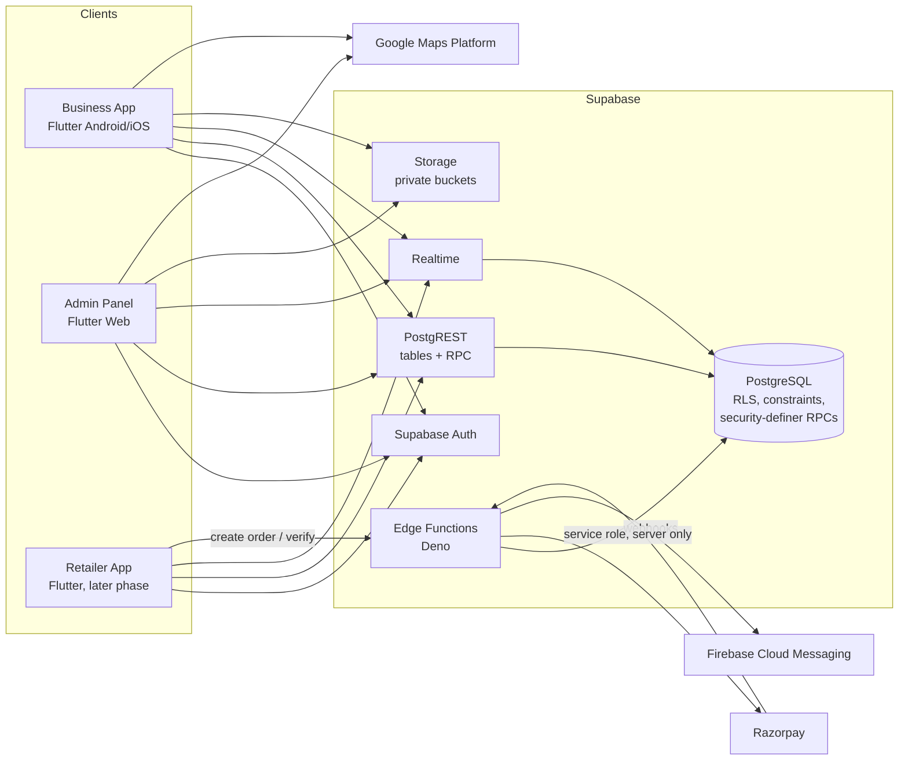
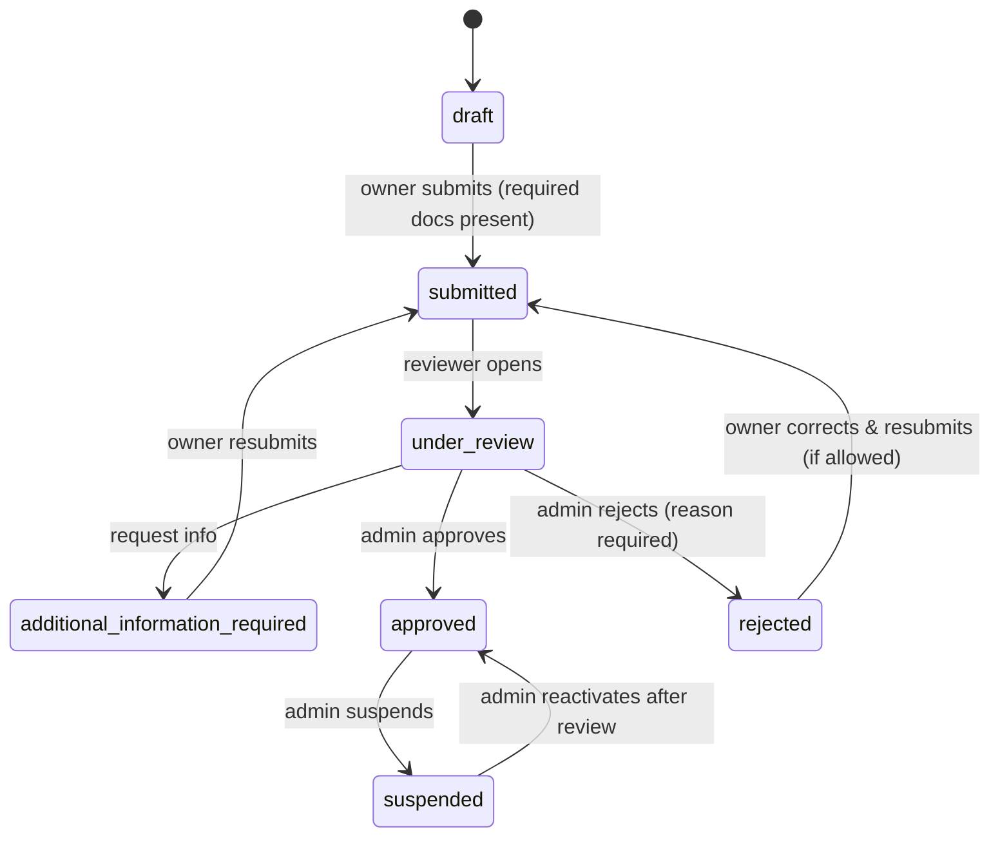
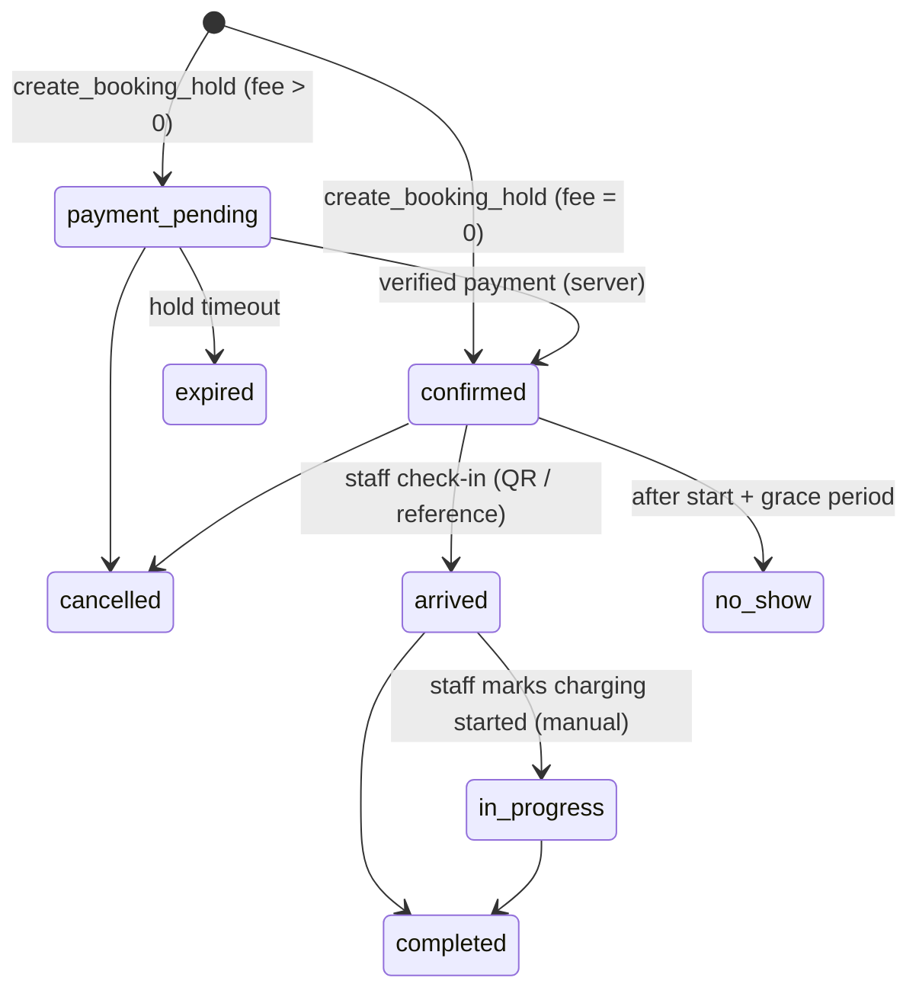
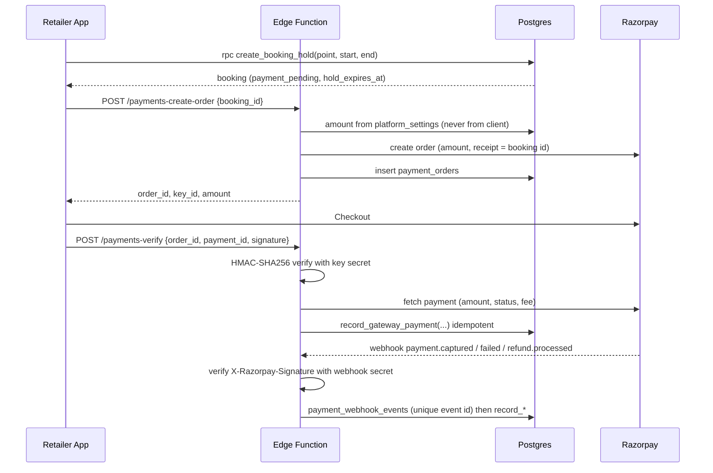

# Architecture

ChargeKaro is an EV charging **slot booking** platform. It reduces waiting time at
charging stations by letting customers reserve a charging point in advance for a
platform booking fee (default INR 12, configured on the backend). The platform
never collects, holds or settles the charging fee itself: that is paid directly
by the customer to the station owner at the station.

## 1. Application boundaries



| Component | Responsibility | Trust level |
|---|---|---|
| Business App (`apps/business_app`) | Station owners, managers and staff: onboarding, stations, charging points, availability, bookings, check-in, maintenance, compliance, notifications, reports | Untrusted client, anon/publishable key + user JWT |
| Admin Panel (`apps/admin_panel`) | Platform staff: onboarding review, documents, stations, bookings, finance, expenses, settings, audit | Untrusted client, anon/publishable key + user JWT |
| Retailer App (`apps/retailer_app`) | Future customer app. Only a placeholder now; backend RPCs for booking holds and payments already exist | Untrusted client |
| PostgreSQL | **Authoritative** for permissions, statuses, booking conflicts, payment state and financial calculations | Trusted |
| Edge Functions (`supabase/functions`) | Razorpay order creation, signature + webhook verification, refunds, FCM dispatch, scheduled jobs | Trusted, holds secrets |

### Admin Panel technology choice

The Admin Panel is **Flutter Web**. Both apps share the same Dart models,
enums, validation rules and Supabase data layer (`packages/*`), so status
transitions, money formatting and form rules are written once. The admin UI
uses a desktop-first layout (sidebar, top bar, paginated data tables) that
collapses to a drawer on tablets. Next.js would give slightly better SEO and
initial load, but the admin panel is behind a login and gains nothing from
SEO, while a second language would duplicate every model and validator.

## 2. Repository structure

```
ev-charging-platform/
  apps/
    business_app/        Flutter (Android, iOS)
    admin_panel/         Flutter Web
    retailer_app/        README only: future phase
  packages/
    shared_models/       Pure Dart: enums, entities, Money (paise), state machines
    shared_validation/   Pure Dart: form validators (phone, PIN code, GSTIN, coordinates, files)
    shared_data/         Flutter: Supabase client bootstrap, repositories, error mapping
    shared_ui/           Flutter: theme, status chips, async/empty/error views, dialogs
  supabase/
    config.toml
    migrations/          Versioned SQL, the only way the schema changes
    functions/           Edge Functions (Deno + TypeScript)
    tests/               Database integration tests (Node test runner + pg)
    seed.sql             Local development data, clearly marked DEMO
  docs/                  This folder
  .github/workflows/     CI
```

## 3. Domain model

See [database_schema.md](database_schema.md) for every table, column group,
constraint and the ER diagram. The main separations the spec asks for:

| Concern | Where it lives |
|---|---|
| User identity | `auth.users` + `profiles` |
| Platform staff role | `platform_staff` (+ `platform_role_permissions`, `platform_staff_permission_overrides`) |
| Business ownership | `businesses.owner_id` + `business_members(role = owner)` |
| Staff membership | `business_members` + `station_assignments` with per-member permission list |
| Station approval | `station_applications` + `application_events` (timeline) |
| Station lifecycle | `stations.status` (separate from application status) |
| Charging point status | `charging_points.operational_status` + `status_source` (manual vs telemetry) |
| Reservations | `bookings` (status) – BOOKED is derived from bookings, never stored on the point |
| Booking-fee payment | `bookings.payment_status`, `payment_orders`, `payments` |
| Refunds | `refunds` |
| Platform financial ledger | `ledger_entries` (append-only, idempotent per source) |
| Operating expenses | `platform_expenses` + `expense_attachments` |

## 4. Main workflows

### Station onboarding



All transitions run in security-definer RPCs (`submit_station_application`,
`start_application_review`, `request_application_information`,
`approve_station_application`, `reject_station_application`,
`suspend_station`, `reactivate_station`). Each writes an `application_events`
row, an `audit_logs` row and a notification in the same transaction. Owners can
never move an application past `submitted`.

### Booking lifecycle



Double booking is prevented by a PostgreSQL **exclusion constraint**
`EXCLUDE USING gist (charging_point_id WITH =, occupancy WITH &&)` restricted
to active statuses. Concurrent requests for the same point and overlapping time
cannot both commit, whatever the client does. A lost race returns HTTP 409
(`slot_unavailable`).

Payment hold: a `payment_pending` booking holds the slot for
`platform_settings.payment_hold_minutes` (default 10). Stale holds are expired
by the scheduled job and also lazily, inside `create_booking_hold`, before the
insert so a late job never blocks a new customer.

### Booking-fee payment (Razorpay)



The booking only becomes `confirmed` in `record_gateway_payment`, after amount
and currency match the order. A payment that arrives after the hold expired
re-tries the reservation; if the slot was taken meanwhile, the booking stays
expired and an automatic refund request is created.

## 5. Security model

See [security.md](security.md). Summary:

* RLS enabled on every table in `public`; `anon` has no table access.
* Roles are read from tables keyed by `auth.uid()`, never from client claims or
  user metadata. No client policy can insert into `platform_staff` or change
  `business_members.role`/`permissions` except an owner managing their own
  business's non-owner members.
* Privileged state changes are `SECURITY DEFINER` functions with
  `search_path = ''`, explicit permission checks and audit logging.
* Payment, refund and ledger tables are written only by service-role code
  (Edge Functions). Clients have read access at most.
* `audit_logs`, `ledger_entries`, `application_events`, `booking_events`,
  `document_reviews` are append-only, enforced by triggers.
* Private documents live in private Storage buckets; read access is via RLS on
  `storage.objects` and short-lived signed URLs.

## 6. Milestones

| # | Milestone | Content |
|---|---|---|
| M1 | Backend foundation | Migrations, constraints, RLS, RPCs, storage policies, seed, DB tests |
| M2 | Edge Functions | Razorpay order/verify/webhook/refund, FCM dispatch, scheduled jobs, tests |
| M3 | Shared packages | Models, validation, data layer, UI kit, unit tests |
| M4 | Admin Panel | Auth, dashboard, onboarding queue & review, stations, bookings, finance, expenses, settings, audit |
| M5 | Business App | Auth & account states, onboarding, stations, points, availability, bookings, QR check-in, maintenance, compliance, notifications, reports |
| M6 | Integrations & release | Maps, FCM, CI, build docs, deployment, security checklist |

Progress per deliverable is tracked in [status.md](status.md).
